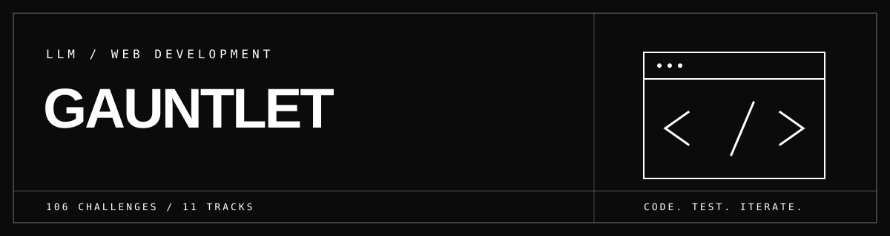

<div align="center">



<p><strong>Web development challenges. One local workspace for testing solutions.</strong></p>

<p><a href="https://github.com/DanDekker/webdev-gauntlet/actions/workflows/ci.yml"></a></p>

<p><a href="#technology-map">Technologies</a> · <a href="#get-started">Get started</a> · <a href="#the-curriculum">Curriculum</a> · <a href="#how-evaluation-works">Evaluation</a> · <a href="#ci-and-container-releases">CI &amp; releases</a></p>

</div>

---

**LLM Webdev Gauntlet** is a local curriculum and evaluation workspace for web development agents. It combines code challenges, an interactive task board, automated checks, and a benchmark of the included reference solutions. The application is called **guantlet-web** and runs on Bun with vanilla JavaScript, HTML, and CSS; it has no runtime package dependencies or build step.

## Technology map

The app uses the first row. The remaining logos show technologies covered by the curriculum. Every logo links to the project’s source repository.

**Built with**

<table>
  <tr>
    <td align="center"><a href="https://github.com/oven-sh/bun"><br>Bun</a></td>
    <td align="center"><a href="https://github.com/tc39/ecma262"><br>JavaScript</a></td>
    <td align="center"><a href="https://github.com/whatwg/html"><br>HTML</a></td>
    <td align="center"><a href="https://github.com/w3c/csswg-drafts"><br>CSS</a></td>
  </tr>
</table>

**Frameworks and UI state in the curriculum**

<table>
  <tr>
    <td align="center"><a href="https://github.com/microsoft/TypeScript"><br>TypeScript</a></td>
    <td align="center"><a href="https://github.com/react/react"><br>React</a></td>
    <td align="center"><a href="https://github.com/vercel/next.js"><br>Next.js</a></td>
    <td align="center"><a href="https://github.com/angular/angular"><br>Angular</a></td>
  </tr>
  <tr>
    <td align="center"><a href="https://github.com/vuejs/core"><br>Vue</a></td>
    <td align="center"><a href="https://github.com/sveltejs/svelte"><br>Svelte</a></td>
    <td align="center"><a href="https://github.com/reduxjs/redux"><br>Redux</a></td>
    <td align="center"><a href="https://github.com/TanStack/query"><br>TanStack Query</a></td>
  </tr>
</table>

**Server and API tooling in the curriculum**

<table>
  <tr>
    <td align="center"><a href="https://github.com/nestjs/nest"><br>NestJS</a></td>
    <td align="center"><a href="https://github.com/trpc/trpc"><br>tRPC</a></td>
    <td align="center"><a href="https://github.com/colinhacks/zod"><br>Zod</a></td>
    <td align="center"><a href="https://github.com/honojs/hono"><br>Hono</a></td>
    <td align="center"><a href="https://github.com/fastify/fastify"><br>Fastify</a></td>
  </tr>
</table>

**Package ecosystems in the curriculum**

<table>
  <tr>
    <td align="center"><a href="https://github.com/npm/cli"><br>npm</a></td>
    <td align="center"><a href="https://github.com/pnpm/pnpm"><br>pnpm</a></td>
    <td align="center"><a href="https://github.com/yarnpkg/berry"><br>Yarn</a></td>
    <td align="center"><a href="https://github.com/denoland/deno"><br>Deno</a></td>
    <td align="center"><a href="https://github.com/jsr-io/jsr"><br>JSR</a></td>
  </tr>
</table>

**Payments in the curriculum**

<table>
  <tr>
    <td align="center"><a href="https://github.com/stripe/stripe-node"><br>Stripe</a></td>
    <td align="center"><a href="https://github.com/polarsource/polar"><br>Polar</a></td>
  </tr>
</table>

Logo sources: [Simple Icons and Polar](assets/logos/SOURCES.md).

## Get started

Requires [Bun](https://bun.sh/).

```bash
git clone https://github.com/DanDekker/webdev-gauntlet.git
cd webdev-gauntlet
bun run dev
```

Open **http://localhost:3000**. Use **Demo Agent** on the sign-in screen, then open the curriculum board. Select an exercise to read its prompt, starter code, and acceptance criteria. Submit a JavaScript or TypeScript solution to see assertion results and a diff. The **Benchmark** view runs the bundled reference solutions across the catalog and can export a Markdown report.

For a regular server without file watching, use `bun run start`. Run the test suite with `bun test`.

## The curriculum

The repository currently includes **170 exercises in 41 categories and 21 tracks**, from introductory refactoring to more involved web systems work. Topics include:

| Area | Examples |
| --- | --- |
| Core web engineering | Async flows, performance, architecture, CSS, accessibility |
| Data and identity | Database access, distributed persistence, authentication, security |
| Application systems | Realtime chat, commerce, storefronts, order lifecycles |
| Web platform | HTML, structured data, cookies, storage, HTTP traffic |
| UI engineering | Design tokens, interaction patterns, web components |
| Developer tooling | TypeScript frameworks, migrations, package management |
| Browser platform | Web Workers, streams, WebGPU compute, WebTransport, WebAssembly, WebNN, Digital Credentials |
| Spatial and real-time media | WebXR depth sensing, WebRTC signaling and encoded transforms, SFrame, WebCodecs |
| Agentic web | WebMCP tool APIs, GEO/AEO discovery, agentic commerce protocols |

Each exercise defines a prompt, starter code, acceptance criteria, and a reference solution in [the curriculum catalog](src/curriculum.js). Framework exercise code lives in [individual TypeScript files](exercises/frameworks/) that the catalog imports, and browser-platform and agentic-web code lives in [individual JavaScript files](exercises/platform/) that it imports the same way. Reference solutions are intentionally included for learning and for checking the evaluator; this is an open-book workspace, not a hidden test set.

### CSS engineering and renewal

The dedicated **CSS Engineering** track contains 27 exercises that move from fundamentals through legacy upgrades and advanced platform work. It covers resets and the box model; logical properties and writing modes; floats to Flexbox and Grid; Sass patterns to native CSS; specificities and cascade layers; fluid type and responsive media; accessibility; and rendering, print, and interaction behavior. Existing exercises extend the path through container queries, subgrid, typed design tokens, scroll-driven animation, anchor positioning, and popovers.

The newest exercises cover bounded `@scope`, the proposed `@function` and `if()` syntax, and cross-document View Transitions. These proposals are evolving W3C drafts; the curriculum labels the experimental syntax and asks for production fallbacks where appropriate. See the [CSS standards references](links.md#css-specifications-and-emerging-proposals).

| Renewal stage | Topics |
| --- | --- |
| Foundations | Reset strategy, box sizing, logical properties, Flexbox, intrinsic Grid, typography, responsive images and mobile viewport units |
| Modernization | Sass-to-native CSS, layered cascades, feature-query fallbacks, `:has()` state, native popover transitions |
| Production quality | Keyboard focus, reduced motion, forced colors, font loading, content visibility, scroll snap and print styles |
| Advanced platform | Container queries, subgrid, OKLCH tokens, scroll-driven animations, anchor positioning, `@scope`, custom CSS functions, `if()` and cross-document view transitions |

### Frontend framework exercises

| Framework | Exercise |
| --- | --- |
| React 19 and Next.js | [Typed server action and optimistic updates](exercises/frameworks/ts_react_nextjs_server_actions/starter.ts) |
| Angular | [Signals and cancelable async state](exercises/frameworks/ts_angular_signals_computed_rx/starter.ts) |
| Vue 3 and Svelte 5 | [Migrate React hooks to fine-grained reactivity](exercises/frameworks/migrate_react_hooks_to_svelte5_vue3_signals/starter.ts) |
| Next.js App Router | [Migrate from Pages Router data loading](exercises/frameworks/migrate_nextjs_pages_to_app_router_rsc/starter.ts) |
| TanStack Query | [Replace Redux thunks with a typed cache](exercises/frameworks/migrate_redux_thunks_to_tanstack_query_ts/starter.ts) |

GitHub's **Languages** bar counts source file types, not frameworks. These exercises contribute to **TypeScript** there; React and Angular do not appear as separate languages. The Vue and Svelte exercise models their reactive primitives in TypeScript rather than shipping `.vue` or `.svelte` components.

### Browser platform exercises

| Platform primitive | Exercise |
| --- | --- |
| Web Workers | [Transferable `ArrayBuffer` chunked reduction](exercises/platform/web_workers/transferable_offload/starter.js) |
| Web Workers | [`SharedArrayBuffer` + `Atomics` race-free counter](exercises/platform/web_workers/shared_atomics_counter/starter.js) |
| Web Workers | [Bounded worker pool with graceful drain](exercises/platform/web_workers/pool_lifecycle/starter.js) |
| Streams | [Streaming NDJSON frame decoder](exercises/platform/web_streams/json_frame_decoder/starter.js) |
| Streams | [Resumable SSE parser with `Last-Event-ID`](exercises/platform/web_streams/sse_reconnect_parser/starter.js) |
| Streams | [Constant-memory streaming checksum](exercises/platform/web_streams/streaming_checksum/starter.js) |
| WebGPU | [Tile compute dispatches within adapter limits](exercises/platform/webgpu/dispatch_tiling/starter.js) |
| WebGPU | [Negotiate only supported features and limits](exercises/platform/webgpu/capability_selection/starter.js) |
| WebGPU | [Read back results with aligned staging buffers](exercises/platform/webgpu/buffer_readback/starter.js) |
| WebRTC | [Resolve simultaneous offers with perfect negotiation](exercises/platform/webrtc/perfect_negotiation/starter.js) |
| WebRTC | [Buffer trickle ICE across remote-description and restart boundaries](exercises/platform/webrtc/ice_candidate_inbox/starter.js) |
| WebRTC | [Control data-channel send pressure by queued UTF-8 bytes](exercises/platform/webrtc/data_channel_backpressure/starter.js) |
| WebCodecs | [Bound the encoder queue and release every frame](exercises/platform/webcodecs/bounded_encode_queue/starter.js) |
| WebCodecs | [Map source-clock timestamps to monotonic microseconds](exercises/platform/webcodecs/timestamp_mapper/starter.js) |
| WebCodecs | [Flush before changing decoder configuration](exercises/platform/webcodecs/decoder_config_router/starter.js) |
| WebTransport | [Bound datagrams by expiry, size and backpressure](exercises/platform/webtransport/datagram_sender/starter.js) |
| WebTransport | [Reassemble length-prefixed stream messages](exercises/platform/webtransport/framed_stream/starter.js) |
| WebTransport | [Reject duplicate and stale datagrams across sequence wrap](exercises/platform/webtransport/datagram_replay_window/starter.js) |
| WebAssembly | [Refresh memory views after growth and validate pointers](exercises/platform/webassembly/memory_view/starter.js) |
| WebAssembly Component Model | [Enforce owned and borrowed resource lifetimes](exercises/platform/webassembly/component_resources/starter.js) |
| WebAssembly JSPI proposal | [Bridge promises across experimental boundaries](exercises/platform/webassembly/jspi_bindings/starter.js) |
| WebNN | [Run a graph with permissioned tensors and cleanup](exercises/platform/webnn/tensor_inference/starter.js) |
| WebNN | [Serialize concurrent runs over shared tensors](exercises/platform/webnn/shared_tensor_queue/starter.js) |
| WebNN | [Recover inference sessions after context loss](exercises/platform/webnn/context_loss_runner/starter.js) |
| Digital Credentials | [Build capability-gated presentation and issuance requests](exercises/platform/digital_credentials/request_builder/starter.js) |
| Digital Credentials | [Preserve user activation and single-flight credential choosers](exercises/platform/digital_credentials/prompt_coordinator/starter.js) |
| Digital Credentials | [Forward opaque responses to a same-origin verifier](exercises/platform/digital_credentials/server_verification/starter.js) |
| WebXR Depth Sensing | [Negotiate required or optional depth features](exercises/platform/webxr_depth/session_options/starter.js) |
| WebXR Depth Sensing | [Sample depth in meters without assuming buffer encoding](exercises/platform/webxr_depth/depth_sampling/starter.js) |
| WebXR Depth Sensing | [Run a failure-safe per-view depth frame loop](exercises/platform/webxr_depth/frame_loop/starter.js) |
| WebRTC Encoded Transform | [Attach a worker-based RTCRtpScriptTransform](exercises/platform/webrtc_encoded_transform/script_transform/starter.js) |
| WebRTC SFrame | [Rotate keys without an undecryptable media window](exercises/platform/webrtc_encoded_transform/sframe_key_rotation/starter.js) |
| WebRTC Encoded Transform | [Keep frame transforms synchronous and ownership-safe](exercises/platform/webrtc_encoded_transform/frame_pipe/starter.js) |

Digital Credentials, WebXR depth sensing, and WebRTC Encoded Transform are evolving
W3C drafts. Their exercises use injected APIs and device shims, and separate optional
capabilities from required ones so they can be evaluated without a wallet, headset, or
browser-specific media implementation. See [links.md](links.md) for primary specs.

### Agentic web exercises

| Area | Exercise |
| --- | --- |
| WebMCP | [Tool registry with spec name validation and abort unregistration](exercises/platform/webmcp/tool_registry/starter.js) |
| WebMCP | [`executeTool` with JSON round-trip and `DOMException` error taxonomy](exercises/platform/webmcp/tool_execution/starter.js) |
| WebMCP | [Cross-origin tool exposure with `exposedTo` allowlists](exercises/platform/webmcp/origin_exposure/starter.js) |
| GEO / AEO | [Generate a spec-shape `/llms.txt` v2 discovery file](exercises/platform/agentic_seo/llms_txt_generator/starter.js) |
| GEO / AEO | [Validate `/llms.txt` and resolve the most specific covering file](exercises/platform/agentic_seo/llms_txt_validator/starter.js) |
| GEO / AEO | [AI crawler classification and RFC 9309 longest-match evaluation](exercises/platform/agentic_seo/ai_crawler_policy/starter.js) |
| Agentic commerce | [Agentic Commerce checkout session lifecycle and idempotency](exercises/platform/agentic_commerce/acp_checkout_session/starter.js) |
| Agentic commerce | [x402 v2 HTTP 402 payment gate with CORS header disclosure](exercises/platform/agentic_commerce/x402_payment_gate/starter.js) |
| Agentic commerce | [AP2 checkout mandate verification with hash binding](exercises/platform/agentic_commerce/ap2_mandate_verification/starter.js) |

These exercises track live 2026 drafts and protocols. The primary sources behind each one are cited in [links.md](links.md).

## How evaluation works

The [evaluator](src/evaluator.js) combines structural checks with task-specific runtime assertions. It reports pass/fail results, a score, execution time, and a line diff. TypeScript submissions are transpiled with Bun before evaluation. The [benchmark suite](src/benchmark.js) runs those same checks against the bundled reference solutions, either for one category or for the full catalog.

Evaluation uses `node:vm` to run submitted code. **A VM context is not a security boundary.** Run this application locally with code you trust; do not expose the evaluator as a public service for untrusted submissions.

## Project layout

| Path | Purpose |
| --- | --- |
| [`src/curriculum.js`](src/curriculum.js) | Exercise catalog and tracks |
| [`exercises/frameworks/`](exercises/frameworks/) | TypeScript starter and reference files for framework challenges |
| [`exercises/platform/`](exercises/platform/) | Starter and reference files for browser platforms, GPU, realtime media, and agentic-web challenges |
| [`src/evaluator.js`](src/evaluator.js) | Solution checks and runtime assertions |
| [`src/benchmark.js`](src/benchmark.js) | Catalog statistics and benchmark reports |
| [`src/server.js`](src/server.js) and [`src/api.js`](src/api.js) | Bun server and HTTP routes |
| [`src/store.js`](src/store.js) | JSON-backed task boards and persistence |
| [`public/`](public/) | Browser interface and web components |
| [`tests/`](tests/) | Bun tests for the curriculum and application modules |
| [`.github/workflows/`](.github/workflows/) | CI checks and tagged container publishing |
| [`Dockerfile`](Dockerfile) | Bun runtime image for local use and releases |

The server stores local state in `data/`, which is ignored by Git. Set `PORT` to change the HTTP port or `GUANTLET_WEB_DATA_DIR` to move the data directory.

## CI and container releases

GitHub Actions runs the Bun test suite on Linux and macOS for pushes and pull requests. It also builds the container and checks that the HTTP server responds. [Dependabot](.github/dependabot.yml) proposes updates for workflow actions and the Bun base image.

Version tags such as `v1.0.0` trigger a tested container build published to `ghcr.io/dandekker/webdev-gauntlet:1.0.0`. The workflow also tags the latest stable release as `latest`. No image is published from pull requests.

To run the container locally:

```bash
docker build -t webdev-gauntlet .
docker run --rm -p 127.0.0.1:3000:3000 -v webdev-gauntlet-data:/data webdev-gauntlet
```

The volume keeps local board and account data between runs. Keep the evaluator on a trusted local machine; it executes submitted code in a VM context.

## Scope

The project also contains local demos for auth, OAuth, chat, storefront flows, web traffic, and design systems. They provide hands-on context for the exercises. The seeded sign-in accounts are for local use only; replace them before using this application in any shared environment.
